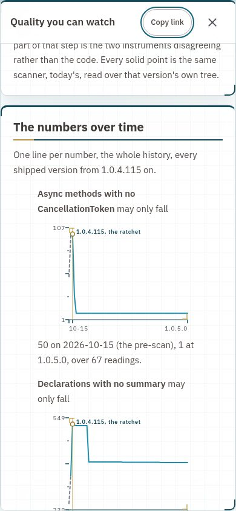

# ADR: Quality you can watch

Status: accepted, 2026-11-10, at 1.0.5.0, the first move in the third number since 1.0.4.0. A new top-level section, Quality, holds one page that shows every rule beside its test, the history of the fourteen numbers of the quality ratchet from the version it went in, coverage from CI on main, and CodeRabbit's level and log. Every number on it is read from a data file the build carries, and a test holds the page to the data.

## Reading list

1. [ADR: The numbers that may only fall](https://theyard.stevenstout.biz/?doc=adr-the-numbers-that-may-only-fall): the ratchet whose history this page draws.
2. [ADR: The rules a change has to pass](https://theyard.stevenstout.biz/?doc=adr-rules): the table the page renders whole.
3. [ADR: CodeRabbit, one rung at a time](https://theyard.stevenstout.biz/?doc=adr-coderabbit-one-rung-at-a-time): the reviewer whose level and log the page shows.
4. [ADR: Counting what the tests cover](https://theyard.stevenstout.biz/?doc=adr-coverage): the floor the coverage line sits against.

## In plain words

The proof that this codebase's quality held was already there: decision records enforced by tests, and a scanner that fails any version that makes one of fourteen numbers worse. It lived in a JSON file nobody opens. Now it is a page anyone can open from the sidebar, the README and the review route, with a line for each number over every version since the ratchet went in, including the two weeks before it, when the numbers got worse.

What that is worth: a hiring manager or a new developer sees in under a minute that quality is measured on every change and can only move one way, and can check every number against the file it came from.

## Context

Steve, 9 November: "I'm worried our code quality maybe slipping as I'm so focused on job hunting, and I need to prove I take code and production quality seriously", then "which is good my ADRs are doing their job with our tests" and "I think this is our next big sell and milestone". Three calls were made with the brief: the milestone is 1.0.5.0; one new top-level section, Quality, holding this page; and the history is rebuilt from git, not estimated.

The honest shape matters more than the direction. The numbers slipped from 15 October to 29 October while every yes-or-no rule held, ADR-122 went in at 1.0.4.115, and they turned. A chart that only ever goes down would read as staged, so the slip is drawn.

## Decision

1. **One history file, rebuilt from git.** `scripts/quality_history.py rebuild` exports the tree of every version commit on main from 1.0.4.115 on and measures it with this checkout's `.github/quality.py`, so the whole history is read by one instrument; each row also keeps the limits the ratchet file held at that version, which is what the gate enforced then. The two readings from before the scanner existed (15 and 22 October) come from the pre-scan of 29 October, marked "pre-scan" in the file and dashed on the charts. Coverage comes from the notice CI on main writes for each version's commit, read through GitHub's API. The file is `data/quality-history.json`, beside the results file the site already serves.
2. **One row per ship, from now on.** promote.sh runs `quality_history.py append <version>` before it folds the results, measuring the tree it ships, and fills coverage for earlier rows that CI has since measured. A failed measurement warns and never stops a ship.
3. **The page is a document, its numbers live.** `docs/quality/QUALITY.md` writes no number of its own. Every number is a live placeholder the API expands at request time (`QualityCounts`), each chart is a `quality-trend` fence the API fills with the readings and the browser draws with the Admin tab's frame, axis and series colours (`QualityTrend`), the rules table is ADR-075's table rendered row for row with each row's tests and their result in the gate this build shipped from, and CodeRabbit's level and log are read from ADR-129 and its findings file.
4. **The whole history is the window.** Versions sit evenly along the bottom, because a busy day ships ten and a quiet week none, and 1.0.4.115 is marked in gold on every chart.
5. **The front door.** README's first screen, the review route's decision stop ("link from an existing stop", the default named in the brief, so the route keeps seven stops) and About's evidence list each link the page once.
6. **The first three numbers are the owner's, and now have a way to move.** promote.sh refused any move past the fourth number. A move in the third number to `x.y.z+1.0` now ships by hand only, with the person promoting naming it as `OWNER_YES=<version>` and the version's own record carrying the owner's yes, which for 1.0.5.0 is the brief's first call above. In the gate the promote job ends green with a notice and moves nothing, as it does for a version that changes a workflow.

## The history at this version

From the file this build carries: {{live:quality-versions}} measured versions. Async methods with no CancellationToken {{live:quality-first async_without_cancellation}} on 15 October, worst {{live:quality-peak async_without_cancellation}}, now {{live:quality-now async_without_cancellation}}. Declarations with no summary worst {{live:quality-peak undocumented_declarations}}, now {{live:quality-now undocumented_declarations}}. Line coverage now {{live:coverage-now lines}} per cent, branches {{live:coverage-now branches}}.

## What holds it

`QualityHistoryTests`: the history starts at 1.0.4.115 with the pre-scan rows before it, runs in version order with every number the ratchet names, and its newest row equals what the scanner reads at HEAD once that version has its row; every live number on the page expands from the data; and the page's prose types no number but dates, the 300-line cap and the coverage floor. `qualityTrend.test.ts` and `qualityBlocks.test.ts`: the fence read, the points placed, the pre-scan dashed and the marker on its version. `PromoteScriptTests`: the owner's number refused without the yes, refused when it skips, and promoted with it. `siteMap.test.ts`: the section in its place.

## Consequences

- The history is measured by today's scanner, so an early row can differ from what the gate held that day when a later addendum to ADR-122 corrected a count. The row's limits say what the gate held; the numbers say what the code was, measured one way.
- Every ship spends about ten seconds more in promote, measuring its tree.
- Coverage for a version arrives after it ships, because CI on main runs after the promote; the next ship fills it.

## Where it sits

Outside the rings for the data and the script (data/ and scripts/ beside the results file and promote.sh); the live numbers in the host's Docs slice beside LiveCounts; the fence in src/library beside the Style section's, the arithmetic in src/lib, the chart in its own component folder; the section in the site map.

## Files

- [`data/quality-history.json`](https://github.com/SteveStout/TheYard/blob/main/data/quality-history.json) - one row per shipped version
- [`scripts/quality_history.py`](https://github.com/SteveStout/TheYard/blob/main/scripts/quality_history.py) - rebuild, append, coverage
- [`docs/quality/QUALITY.md`](https://github.com/SteveStout/TheYard/blob/main/docs/quality/QUALITY.md) - the page
- [`api/TheYard.Api/Features/Docs/QualityCounts.cs`](https://github.com/SteveStout/TheYard/blob/main/api/TheYard.Api/Features/Docs/QualityCounts.cs) - every live number on it
- [`src/lib/qualityTrend.ts`](https://github.com/SteveStout/TheYard/blob/main/src/lib/qualityTrend.ts), [`src/library/qualityBlocks.ts`](https://github.com/SteveStout/TheYard/blob/main/src/library/qualityBlocks.ts) and [`src/components/shared/QualityTrend/`](https://github.com/SteveStout/TheYard/tree/main/src/components/shared/QualityTrend) - the fence and the chart
- [`scripts/promote.sh`](https://github.com/SteveStout/TheYard/blob/main/scripts/promote.sh) - the row on every ship, and the owner's number
- [`api/TheYard.Tests/QualityHistoryTests.cs`](https://github.com/SteveStout/TheYard/blob/main/api/TheYard.Tests/QualityHistoryTests.cs) - the history and the page, held to the data

## Addendum, 2026-11-10 (1.0.5.1): the page read live, and the first two corrections

1.0.5.0 rolled at 11:52 CST and the page was read on both names at 1280 and 390 by headless Chrome: eleven charts and eleven gold marks at each width, no sideways scroll, every live number expanded (none left as a note), ready in under 3.4 seconds. The SQL site at a desk and the Cosmos DB site on a phone:

Two corrections in this version. CodeRabbit's one finding on 1.0.5.0's request (#8) was right: a row the promote failed to write left the history's newest row two versions behind, and the next version's gate would have gone red on it. The test now allows an earlier newest row, a gap, and refuses only one ahead of the changelog. And the history was measured again by the scanner that counts the fifteenth number (ADR-122, the addendum of 1.0.5.1), so every row from 1.0.4.115 carries it.

## Addendum, 2026-11-10 (1.0.5.2): one instrument from end to end, and what a cold review found

A reviewer with no part in the build read 1.0.5.0 and 1.0.5.1 from three seats. What stopped being true, and what changed:

- **The pre-scan rows are gone.** Decision 1 kept two hand-counted readings from before the scanner existed. The scanner runs on those trees too, so the history now measures the last version of each day from 15 October to the ratchet, then every version, all with today's scanner; the slip is measured the same way as the turn, and nothing is dashed. Rows before 1.0.4.115 carry no limits, because the ratchet file did not exist.
- **The page opens with one table.** The hiring-manager seat read the page in about ninety seconds to its first chart and said the case needs a then, worst and now in one place; each number's reading on 15 October, its worst version and today's, and the limit now, all live.
- **Four statements said more than the data.** "Nothing on this page is typed in" (dates and the coverage floor are typed, named in the test); "the tests fail if it says anything the data does not" (they fail if a live number cannot be read or the prose types a count of its own); "the code doubled" (no number behind it on the page); and "each payment lowers its limit" said of the XML documentation figure, which is not a ratchet number. Each now says only what holds.
- **Each chart marks the version its number joined the ratchet**: 1.0.4.115 for fourteen, 1.0.5.1 for the React headers, and none for the two coverage lines, which have a floor and no ratchet version. The worst of a number that may only rise is its lowest reading.
- **The owner's number in the gate.** promote.sh now ignores OWNER_YES inside the gate, so no environment there can promote a move in the first three numbers, and a test holds the gate's notice path; the comment no longer claims the script checks the record for the yes, which it cannot read.

Left for a later version, from the same review: the rules column counts each test class's results, not the tests that hold that one rule; four versions have no coverage reading (CI did not finish green for 1.0.4.122, .132, .137 and .148) and the page does not yet say why; a row appended by promote records the commit before the results are folded in.

## Addendum, 2026-11-10 (1.0.5.6): the coverage gaps, counted right

What stopped being true: the addendum of 1.0.5.2 says four versions have no coverage reading. The history holds seven measured rows with none: the four whose CI on main did not finish green (1.0.4.122, .132, .137 and .148), two more from before the ratchet, 1.0.3.179 on 18 October and 1.0.3.186 on 19 October, and the newest row, which promote writes before its own CI on main has run and which the next version's pass fills in. CodeRabbit found the miscount on #10. The page still does not say why a reading is missing; that stays for a later version.

The same review's other finding there, that "Limit now" should be read from the ratchet file and not the history, is answered and not changed: the site serves data/ and not .github/, and every row promote writes is measured on the promoted tree, so the newest row's limits are the ratchet file the version shipped with (1.0.5.3's row reads 3,477, as its ratchet did). Only a build between two versions can show a limit the file has already moved past.

## Addendum, 2026-11-11 (1.0.5.16): one paragraph and one chart first

What stopped being true: the page's first sentence, "Every rule this codebase lives by is a test, and fifteen numbers about its shape may only get better", and the addendum of 1.0.5.2's "The page opens with one table". The page now opens with one paragraph and one chart, then the table. The paragraph says what happened in plain words (AI made the work fast, the code slipped for two weeks in October where no test was looking, and the ratchet that turned it), and the chart under it is the async count's whole history with the gold mark at 1.0.4.115. A line under the chart reads its first, worst and today's values from the history. The table follows as before.

The async chart is drawn once: its fence moved from "The numbers over time" to the top, and that section's lead-in now says the async line is at the top of the page. The page still has twelve trend fences, and the line under the top chart adds three placeholders; QualityHistoryTests holds it to no typed number, and quality.spec counts the fences from the served document and finds a chart for each. The new figure is the first on the page to sit above the first second-level heading, inside the title card; the viewer mounts every figure by its data attribute wherever it sits, and a local run at 1,280 by 900 and at 390 by 844 drew it whole on the first screen.

Corrected in 1.0.5.18: this addendum first said the page opens with one sentence; its opening is one paragraph of four sentences, the text Steve approved, and the chart follows it (CodeRabbit on 1.0.5.16).

## Addendum, 2026-11-12 (1.0.5.50): the chart moved to shared

What stopped being true: Decision 3 and the Files list put the chart in its own folder under components/quality. The landing's hook now draws this page's first chart too (ADR: A hook on every page), and a component a second section draws lives under components/shared, so the chart moved to components/shared/QualityTrend; the link above names the new place. The page draws it as before, and nothing on it changed.

## Addendum, 2026-11-17 (1.0.5.78): six cards on what the rules protect

What stopped being true: that the page goes from its one table straight to the engineers' detail. Under its opening paragraph and its first chart, which stay first because the landing and the review route both point at them (ADR-132; stop 1's "Do this", rewritten in this version to name the cards), the page now says in plain words what the rulebook protects: six cards, one for each group of ADR-075's rules (nothing ships unchecked; the architecture keeps its shape; the site stays fast and cheap to run; every page tells the truth; production is watched, not hoped for; the product works). Each card carries a promise, one example paraphrased from a real rule in its group, and a line counted when the page is opened: how many rules, and how their tests did in the gate this build shipped from. A rule held only by the job hunt Function's own suite, which its deploy runs and data/test-results.json does not record test by test, is counted apart rather than called passing. The graphs follow, each now with one line on why that number matters, and the full table is folded at the bottom, unchanged, labelled for engineers. "The slip, and the turn" and "What is still thin" stay, because the honest part is what makes the rest believable.

How the grouping is kept: ADR-075's table is not changed, because three readers parse it by position (RuleTableTests, QualityCounts and scripts/coderabbit_rules.py). The groups live in a side map, data/rule-groups.json, keyed by each rule's exact words; RuleTableTests refuses a rule with no group, a key that matches no rule and a rule in two groups. A new rule therefore needs its group in the same commit. ReviewRecordsTests held every heading a stop told the reader to scroll to as a heading of the page it opens; since the tour went compact (ADR-138, the addendum on one unit) ReviewTourTests holds the one the proof lands on.

## Addendum, 2026-11-20 (1.0.5.130): the page as its picture

What stopped being true: that the Quality page is the record's prose with a chart per number and a table, in the 760 px window every document opens in. Steven, of the dialog, on 20 November: "work this in, this page is so ugly". The picture is J:\mentor\quality1120\mock-QUALITY-page.html with its captures at 1920, 1568, 1440 and 390, every number in it read from data/quality-history.json and the live page at 1.0.5.121.

**One title, one window.** A document's first heading that repeats the window's bar is no longer drawn under it (docLayout.ts, `sayTitleOnce`); it stays in the page, unseen, for a screen reader, as the Author page already kept its own. A first heading with words of its own (the README's "TheYard") is drawn as before. The bar is the site's header bar at every width: the header gradient, the gold bar under it, white words, and for a document the catalogue gives one (`note` in pages.ts) a short line beside Copy link, "Live · read when opened" on this page (DocBar.module.css, split from DocDialog.module.css). From 640 the page behind every document is a soft field, blurred 22 px and saturated under the scrim at 30 per cent (`--dialog-backdrop-bg`, `--dialog-backdrop-filter`); the sheet stays nearly clear and the reading panels go to white at 0.88 (`--dialog-page-bg`). The catalogue's `wide` flag opens a document at `min(1080px, 100vw - 64px)`, centred on the screen, because the rail behind it is now a blur with no word to cut; this page is the one that carries it.

**The cards, in order.** The lede and four readouts (numbers held, versions measured, .NET tests now and at the ratchet, rules with a test); "The slip, and the ratchet": the async chart, its caption and the text of what was "The slip, and the turn", whose address still lands there (a heading may name its own id, `{#the-slip-and-the-turn}`, markdown.ts); "All fifteen numbers, today", fifteen tiles in place of the table; the numbers over time as small multiples, three across; coverage, two charts with their floors; the rulebook's six cards with a gauge each and the full table folded inside the card; CodeRabbit's four readouts over its folded log; what is still thin; in plain words; the ratchet read from this build, folded; the files. Every sentence is the page's own but the merges and the readouts' labels.

**The numbers.** `QualityReadouts.cs` answers the new live measures from the same files the page already read: what the newest limits hold, the span of days measured, each number's value at its own join (the first history row whose limits name it, so the React file headers' note says "when it joined at" their own version and the rest "at the ratchet"), each tile's value, kind, bar and note, and CodeRabbit's counts, where a cell not read yet is counted on its own and never as a zero. The rulebook's cards are now one fence line each, drawn by qualityBlocks.ts.

**The charts.** QualityChart (src/components/shared/QualityChart, src/lib/qualityChart.ts) draws every chart on this page: readings spaced by their day, round labelled gridlines, the line in teal only, the version the number joined in gold, a dot at today and a dashed floor where the fence names one; the first chart adds the slip, "THE RATCHET" with its version and day and three callouts, and on a phone it draws at its own 350 by 330 shape. The home page's chart is the plain QualityTrend as it was.

**Held by** QualityReadoutsTests (the joins, the tile notes, the readouts and CodeRabbit's counts on a repository written for the test), QualityPageTilesTests (the served page against the data: every tile, the held pill, CodeRabbit's readouts against its table, the six cards), RuleGroupCountsTests, DocumentationCatalogTests and ReviewTourTests (a heading's own id), qualityChart.test.ts, qualityBlocks.test.ts, docLayout.test.ts, and quality.spec.ts (one title, the readouts, fifteen tiles three across and two on a phone, every chart drawn with its join and floors, the 1080 px window and the blur behind it at 1440 and 390). On a phone the four readouts stand over the first chart, so it starts on the first screen and runs past its foot, as the picture draws it (hooks.spec.ts).

## Addendum, 2026-11-20 (1.0.5.141): the panel, the numbers and the foot

The page takes the sales pages' look (ADR: The sales pages set the site's look, the addendum on the Quality page), three changes over the picture quality1120 built. **The panel:** the four readouts in the lede are the dark live panel laid on its side, "The ratchet, right now" with the LIVE tag over Numbers held, Versions measured, .NET tests and Rules with a test, each with the value and line it had; the fence names its head after its name (`quality-readouts The ratchet, right now`), and a readouts fence with no head, CodeRabbit's, stays a row of tiles. The words "Live · read when opened" left the sheet's bar, since the panel says it. **The numbers:** every titled card carries its number, 01 The slip, and the ratchet to 10 Files, drawn where the layout draws a card (`docLayout.ts`, for the catalogue's wide sheet, the one flag this page carries); the lede card has none. **The foot:** the sheet ends on one last card, the review route's closing question and its line beside the same three moves, Book 20 minutes, the gold Resume (PDF) and Message me on LinkedIn, each reporting the action its twin on the review route reports, and under them Where next; opened over the review route, "Back to the three questions" closes the sheet and lands on section 02. While the sheet is open each badge takes its pass of light and the panel's live dot breathes, never with reduced motion. Every other document keeps the Where next it has. Held by `docLayout.test.ts`, `qualityBlocks.test.ts`, `reviewVerdict.test.ts` (the foot's three moves), `pageHooks.test.ts`, `documents.test.ts` and `quality.spec.ts` at 390 and 1440.

## Addendum, @DATE@ (@VER@): The Quality page reads in two layers

What stopped being true: that the page is one long sheet every reader goes down. Steven, on 23 November, of this page: "it has so many numbers and stats the question is do they add value?" and "my biggest issue is the layout, there is no way a manager will read through this". The sheet was 6,061 px tall at 1440; it opened on the xUnit count (4,725), which is not the figure the landing's tests tile links here with, and it put debt counts and partial gauges in front of the reader. The picture is J:\mentor\quality1123\mock-QUALITY1123.html with its captures at 390, 1440, 1568 and 1920, reviewed by Fable before any code; nothing on the page is deleted, and the slip stays in.

**The reading layer.** A manager gets the story, four numbers and six promises, and can stop at the end of card 02. The lede is one paragraph over four dark readouts, drawn from a `quality-lede` fence with no head row and no LIVE tag: quality numbers held, tests passed, lines covered as a whole per cent, and versions AI-reviewed since the log's first day. Card 01 is the slip's chart, now with no version anywhere on it (its callouts, its ratchet mark and its band say days), and a caption that tells the slip in words. Card 02 is the six rule groups as promises, a title and a sentence each, drawn from a `quality-promises` fence over the same rule-groups lines, and a foot with the rule count. No version string, debt count or partial gauge stands in the lede or cards 01 and 02.

**One test number.** The page carries one test figure in its reading layer, and it is the landing's: the passes of the suites the landing counts once, summed by the new `tests-passed` measure. The suite list lives twice, COUNTED_ONCE in src/lib/landingProof.ts and QualityReadouts.CountedOnce, so QualityLedeTests reads the first out of the file and holds the second equal to it, and quality.spec.ts holds the readout equal to the landing's tile on the same build. The xUnit count stays as its tile in the numbers fold, named for what it counts.

**What moved into the folds.** Card 03, for engineers, is seven folds, every one closed on load, each a single row with its title, a short summary read from data and a gold-ringed mark: the fifteen tiles, the nine charts over time, coverage, the rulebook's cards with their gauges and the full table, CodeRabbit's readouts and its log, what is still thin, and the ratchet file, the scanner and the files behind the page, where "In plain words" now lives after its first paragraph became the lede. The thin count (the React files with no header) is written in its fold and nowhere else on the page.

**The numbers.** Every new figure is a live measure, none typed: `tests-passed`, `coverage-whole`, `coderabbit-since`, the caption's `quality-worst`, `quality-worst-days`, `quality-at-ratchet`, `quality-slip-span` and `quality-ratchet-day`, and `quality-charted`, the count of charts in the over-time fold (QualityReadouts.Lede.cs). The cards are found by name, not by their words: the lead panel is `lede-card` and the three numbered cards keep the shared `q-card` hook beside `data-card` slip, promise and engineer, from the list beside the page in the catalogue (pages.ts). `#the-slip-and-the-turn` still lands on card 01.

**Held by** QualityLedeTests (the suite list, the lede's four rows, the caption against the history, the fold's chart count, the folds closed and no version in the reading layer), QualityReadoutsTests (the new measures on a repository written for the test), QualityPageTilesTests (the lede and CodeRabbit's readouts each by its own fence), qualityBlocks.test.ts, docLayout.test.ts, qualityChart.test.ts, quality.spec.ts (five cards in order, four readouts, six promises with no gauge, seven folds closed on load and each opening to its block, the tests readout equal to the landing's tile), and the picture's check spec, spec-quality1123.json, at 390, 1440, 1568 and 1920.
