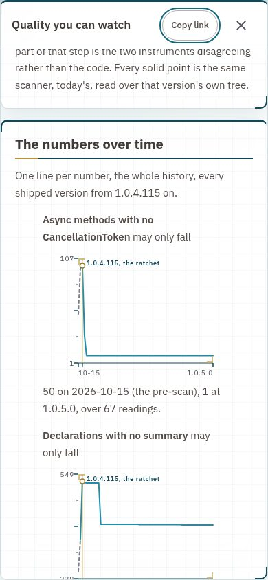

# ADR: Quality you can watch

Status: accepted, 2026-11-10, at 1.0.5.0, the first move in the third number since 1.0.4.0. A new top-level section, Quality, holds one page that shows every rule beside its test, the history of the fourteen numbers of the quality ratchet from the version it went in, coverage from CI on main, and CodeRabbit's level and log. Every number on it is read from a data file the build carries, and a test holds the page to the data.

## Reading list

1. [ADR: The numbers that may only fall](https://theyard.stevenstout.biz/?doc=adr-the-numbers-that-may-only-fall): the ratchet whose history this page draws.
2. [ADR: The rules a change has to pass](https://theyard.stevenstout.biz/?doc=adr-rules): the table the page renders whole.
3. [ADR: CodeRabbit, one rung at a time](https://theyard.stevenstout.biz/?doc=adr-coderabbit-one-rung-at-a-time): the reviewer whose level and log the page shows.
4. [ADR: Counting what the tests cover](https://theyard.stevenstout.biz/?doc=adr-coverage): the floor the coverage line sits against.

## In plain words

The proof that this codebase's quality held was already there: decision records enforced by tests, and a scanner that fails any version that makes one of fourteen numbers worse. It lived in a JSON file nobody opens. Now it is a page anyone can open from the sidebar, the README and the review route, with a line for each number over every version since the ratchet went in, including the two weeks before it, when the numbers got worse.

What that is worth: a hiring manager or a new developer sees in under a minute that quality is measured on every change and can only move one way, and can check every number against the file it came from.

## Context

Steve, 9 November: "I'm worried our code quality maybe slipping as I'm so focused on job hunting, and I need to prove I take code and production quality seriously", then "which is good my ADRs are doing their job with our tests" and "I think this is our next big sell and milestone". Three calls were made with the brief: the milestone is 1.0.5.0; one new top-level section, Quality, holding this page; and the history is rebuilt from git, not estimated.

The honest shape matters more than the direction. The numbers slipped from 15 October to 29 October while every yes-or-no rule held, ADR-122 went in at 1.0.4.115, and they turned. A chart that only ever goes down would read as staged, so the slip is drawn.

## Decision

1. **One history file, rebuilt from git.** `scripts/quality_history.py rebuild` exports the tree of every version commit on main from 1.0.4.115 on and measures it with this checkout's `.github/quality.py`, so the whole history is read by one instrument; each row also keeps the limits the ratchet file held at that version, which is what the gate enforced then. The two readings from before the scanner existed (15 and 22 October) come from the pre-scan of 29 October, marked "pre-scan" in the file and dashed on the charts. Coverage comes from the notice CI on main writes for each version's commit, read through GitHub's API. The file is `data/quality-history.json`, beside the results file the site already serves.
2. **One row per ship, from now on.** promote.sh runs `quality_history.py append <version>` before it folds the results, measuring the tree it ships, and fills coverage for earlier rows that CI has since measured. A failed measurement warns and never stops a ship.
3. **The page is a document, its numbers live.** `docs/quality/QUALITY.md` writes no number of its own. Every number is a live placeholder the API expands at request time (`QualityCounts`), each chart is a `quality-trend` fence the API fills with the readings and the browser draws with the Admin tab's frame, axis and series colours (`QualityTrend`), the rules table is ADR-075's table rendered row for row with each row's tests and their result in the gate this build shipped from, and CodeRabbit's level and log are read from ADR-129 and its findings file.
4. **The whole history is the window.** Versions sit evenly along the bottom, because a busy day ships ten and a quiet week none, and 1.0.4.115 is marked in gold on every chart.
5. **The front door.** README's first screen, the review route's decision stop ("link from an existing stop", the default named in the brief, so the route keeps seven stops) and About's evidence list each link the page once.
6. **The first three numbers are the owner's, and now have a way to move.** promote.sh refused any move past the fourth number. A move in the third number to `x.y.z+1.0` now ships by hand only, with the person promoting naming it as `OWNER_YES=<version>` and the version's own record carrying the owner's yes, which for 1.0.5.0 is the brief's first call above. In the gate the promote job ends green with a notice and moves nothing, as it does for a version that changes a workflow.

## The history at this version

From the file this build carries: {{live:quality-versions}} measured versions. Async methods with no CancellationToken {{live:quality-first async_without_cancellation}} on 15 October, worst {{live:quality-peak async_without_cancellation}}, now {{live:quality-now async_without_cancellation}}. Declarations with no summary worst {{live:quality-peak undocumented_declarations}}, now {{live:quality-now undocumented_declarations}}. Line coverage now {{live:coverage-now lines}} per cent, branches {{live:coverage-now branches}}.

## What holds it

`QualityHistoryTests`: the history starts at 1.0.4.115 with the pre-scan rows before it, runs in version order with every number the ratchet names, and its newest row equals what the scanner reads at HEAD once that version has its row; every live number on the page expands from the data; and the page's prose types no number but dates, the 300-line cap and the coverage floor. `qualityTrend.test.ts` and `qualityBlocks.test.ts`: the fence read, the points placed, the pre-scan dashed and the marker on its version. `PromoteScriptTests`: the owner's number refused without the yes, refused when it skips, and promoted with it. `siteMap.test.ts`: the section in its place.

## Consequences

- The history is measured by today's scanner, so an early row can differ from what the gate held that day when a later addendum to ADR-122 corrected a count. The row's limits say what the gate held; the numbers say what the code was, measured one way.
- Every ship spends about ten seconds more in promote, measuring its tree.
- Coverage for a version arrives after it ships, because CI on main runs after the promote; the next ship fills it.

## Where it sits

Outside the rings for the data and the script (data/ and scripts/ beside the results file and promote.sh); the live numbers in the host's Docs slice beside LiveCounts; the fence in src/library beside the Style section's, the arithmetic in src/lib, the chart in its own component folder; the section in the site map.

## Files

- [`data/quality-history.json`](https://github.com/SteveStout/TheYard/blob/main/data/quality-history.json) - one row per shipped version
- [`scripts/quality_history.py`](https://github.com/SteveStout/TheYard/blob/main/scripts/quality_history.py) - rebuild, append, coverage
- [`docs/quality/QUALITY.md`](https://github.com/SteveStout/TheYard/blob/main/docs/quality/QUALITY.md) - the page
- [`api/TheYard.Api/Features/Docs/QualityCounts.cs`](https://github.com/SteveStout/TheYard/blob/main/api/TheYard.Api/Features/Docs/QualityCounts.cs) - every live number on it
- [`src/lib/qualityTrend.ts`](https://github.com/SteveStout/TheYard/blob/main/src/lib/qualityTrend.ts), [`src/library/qualityBlocks.ts`](https://github.com/SteveStout/TheYard/blob/main/src/library/qualityBlocks.ts) and [`src/components/quality/QualityTrend/`](https://github.com/SteveStout/TheYard/tree/main/src/components/quality/QualityTrend) - the fence and the chart
- [`scripts/promote.sh`](https://github.com/SteveStout/TheYard/blob/main/scripts/promote.sh) - the row on every ship, and the owner's number
- [`api/TheYard.Tests/QualityHistoryTests.cs`](https://github.com/SteveStout/TheYard/blob/main/api/TheYard.Tests/QualityHistoryTests.cs) - the history and the page, held to the data

## Addendum, 2026-11-10 (1.0.5.1): the page read live, and the first two corrections

1.0.5.0 rolled at 11:52 CST and the page was read on both names at 1280 and 390 by headless Chrome: eleven charts and eleven gold marks at each width, no sideways scroll, every live number expanded (none left as a note), ready in under 3.4 seconds. The SQL site at a desk and the Cosmos DB site on a phone:

Two corrections in this version. CodeRabbit's one finding on 1.0.5.0's request (#8) was right: a row the promote failed to write left the history's newest row two versions behind, and the next version's gate would have gone red on it. The test now allows an earlier newest row, a gap, and refuses only one ahead of the changelog. And the history was measured again by the scanner that counts the fifteenth number (ADR-122, the addendum of 1.0.5.1), so every row from 1.0.4.115 carries it.

